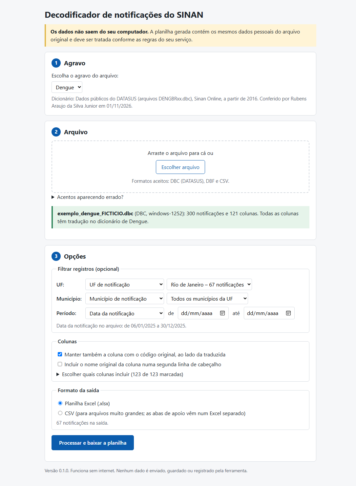

# Decodificador de notificações do SINAN

Ferramenta gratuita que recebe um arquivo público de notificações do SINAN, baixado do DATASUS, e devolve uma planilha com os códigos traduzidos para linguagem legível, conforme o dicionário de dados oficial. Todo o processamento acontece no navegador: os dados não saem do computador.

**Versão 1.0.1** (15/11/2026). Autor: Rubens Araujo da Silva Junior.

A versão 1.0.1 tem o mesmo programa de decodificação e os mesmos dicionários da 1.0.0 (02/11/2026), que é a versão registrada no INPI e descrita no artigo. Ela acrescenta a licença, o arquivo de citação e a omissão de números de CPF nos nomes de estabelecimentos do CNES.

**Agravos disponíveis:** Dengue, Chikungunya, Zika, Leishmaniose Tegumentar Americana e Leishmaniose Visceral. Os dicionários foram conferidos pelo Rubens em 01/11/2026 e 02/11/2026.

**Validação:** a ferramenta foi comparada com o pacote microdatasus nos cinco agravos, e uma amostra de 500 células foi conferida à mão. O resultado foi 0 erros de tradução (IC 95%: 0% a 0,74%). Ver [comparação](docs/validacao/relatorio-comparacao-microdatasus.md) e [conferência por amostra](docs/validacao/relatorio-conferencia-amostra.md).

## Para quem vai usar

1. Descompacte `decodificador-sinan-<versão>.zip`.
2. Dê dois cliques em `decodificador-sinan/index.html` (Chrome ou Edge). Não precisa de internet.
3. Escolha o agravo e o arquivo (DBC do DATASUS, DBF ou CSV), ajuste as opções e clique em "Processar e baixar a planilha".

Para analisar no R, Stata ou Python, marque "Formato para análise". Assim saem nomes de coluna do SINAN em minúsculas, a idade em anos como número e um CSV no padrão internacional.

Instruções completas, com fotos de cada passo e de como baixar o arquivo no site do DATASUS, no [guia de uso em PDF](docs/guia-de-uso.pdf). O resumo em texto está em [docs/LEIA-ME.txt](docs/LEIA-ME.txt), que também vai dentro do pacote. A pasta `exemplos/` tem arquivos fictícios para experimentar.

## Organização das pastas

| Pasta | Conteúdo |
|---|---|
| `docs/` | Requisitos, fontes oficiais (`docs/fontes`), inventário das fontes, conferência dos dicionários, validação (`docs/validacao`), relatório de testes e de desempenho |
| `validacao/` | Scripts da validação: comparação com o microdatasus (R) e conferência por amostra |
| `src/leitura/` | Leitura de DBC, DBF e CSV |
| `src/decodificacao/` | Tradução dos códigos e regras especiais (datas, idade) |
| `src/saida/` | Geração de Excel e CSV |
| `src/interface/` | Tela e processamento em segundo plano |
| `dicionarios/` | Dicionários por agravo (JSON) e tabelas de apoio (IBGE, DATASUS, CNES, CBO) |
| `ferramentas/` | Programas de apoio ao desenvolvimento |
| `testes/` | Testes automáticos, somente com arquivos fictícios |
| `exemplos/` | Arquivos fictícios de demonstração |
| `dados_publicos/` | Arquivos reais do DATASUS, só no computador do desenvolvedor. **Não entra no Git nem na versão distribuída** |

## Para quem desenvolve

Requer Git, Node.js e, para o teste no navegador, o Microsoft Edge.

| Comando | O que faz |
|---|---|
| `npm install` | Instala as dependências (esbuild e fflate) |
| `npm test` | Roda os testes automáticos |
| `npm run verificar` | Verifica os dicionários e as tabelas |
| `npm run conferencia` | Gera a planilha de conferência do dicionário de dengue (outros agravos: `node ferramentas/gerar-conferencia.js dicionarios/<agravo>.json`) |
| `npm run exemplos` | Gera os arquivos fictícios de exemplo |
| `npm run construir` | Monta `dist/decodificador-sinan/` e o `.zip` de distribuição |
| `npm run testar-navegador` | Abre a ferramenta no Edge, processa um exemplo e confere que não houve conexão de rede |
| `node ferramentas/decodificar.js <arquivo> --uf 33` | Processa um arquivo pelo terminal (saída em `dados_publicos/saida/`) |

Para acrescentar um agravo: transcrever o dicionário em `dicionarios/<agravo>.json` a partir dos documentos de `docs/fontes`, rodar `npm run verificar`, gerar e conferir a planilha de conferência e marcar o dicionário como conferido. Só dicionários conferidos entram no pacote.

Relatórios: [testes](docs/relatorio-testes.md), [desempenho](docs/desempenho.md), [inventário das fontes](docs/inventario-fontes.md), [validação](docs/validacao/).

## Como citar

Os dados para citação estão em [CITATION.cff](CITATION.cff). O código está arquivado no Zenodo: DOI da versão 1.0.1 [10.5281/zenodo.24245072](https://doi.org/10.5281/zenodo.24245072); DOI geral, que aponta sempre para a versão mais recente, [10.5281/zenodo.24245071](https://doi.org/10.5281/zenodo.24245071).

SILVA JUNIOR, R. A. **Decodificador de notificações do SINAN**. Versão 1.0.1. 2026. Zenodo. DOI: 10.5281/zenodo.24245072. Programa de computador registrado no INPI, processo BR512026010321-5.

## Licença

Copyright (C) 2026 Rubens Araujo da Silva Junior.

Este programa é software livre: você pode redistribuí-lo e modificá-lo nos termos da Licença Pública Geral GNU (GNU GPL), versão 3 ou, a seu critério, qualquer versão posterior, publicada pela Free Software Foundation. Ele é distribuído na esperança de ser útil, mas SEM NENHUMA GARANTIA, nem mesmo a garantia implícita de COMERCIALIZAÇÃO ou de ADEQUAÇÃO A UM FIM ESPECÍFICO. O texto completo da licença, em inglês, está em [LICENSE](LICENSE).

Em termos simples: qualquer pessoa pode usar, copiar, estudar e modificar a ferramenta, mas quem distribuir uma versão modificada precisa manter o aviso de autoria e liberar o código dessa versão sob a mesma licença.

Registro no INPI: programa de computador "Decodificador de notificações do SINAN", processo BR512026010321-5 (certificado expedido em 10/11/2026).

Código de terceiros incluído:

- **fflate** 0.8.2, de Arjun Barrett, sob a licença MIT (compactação dos arquivos Excel e da tabela do CNES).
- **blast.c**, de Mark Adler (contrib/blast do zlib), adaptado para JavaScript em `src/leitura/blast.js`, sob a licença zlib (descompactação dos arquivos DBC).

As duas licenças são compatíveis com a GPL, e os avisos originais estão mantidos no código.
